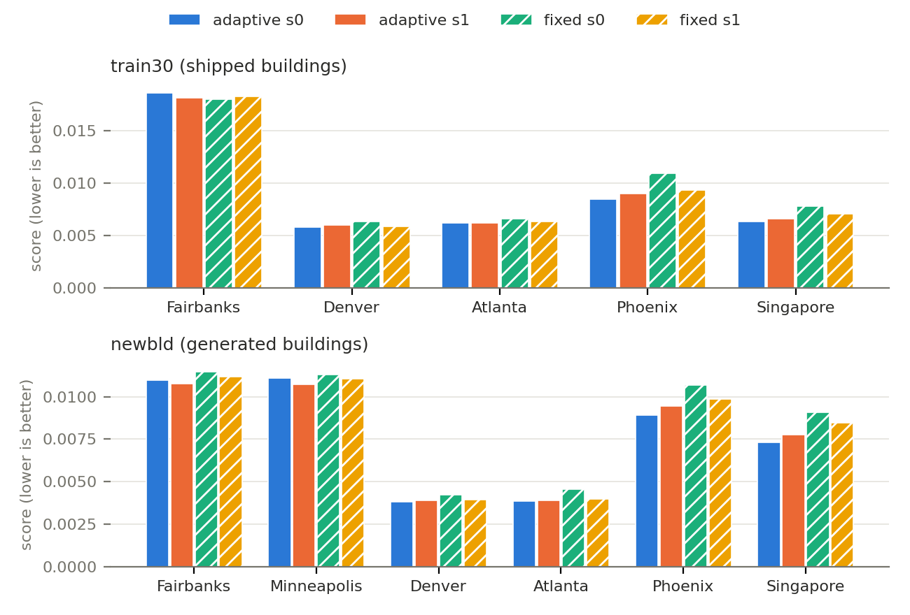

## What it is

Hypocaust is a climate controller for office buildings, built for the NeurIPS 2026 Smart Buildings Competition. Every five minutes it decides how to run the heating, cooling and air handling in every zone of a building.

The name comes from the Roman underfloor heating system.

## What it does

- Keeps each zone inside its comfort range, aiming for the cheapest comfortable temperature rather than the middle of the range.
- Runs the air handlers and the hot water system only as hard as the zones need.
- Turns the building down when it is empty and brings it back up in time for the morning.
- Learns how each room responds while it runs, and adjusts itself.

## How it works

Each zone has its own simple feedback loop that steers its temperature toward a target. The central plant follows what the zones ask for.

While it runs, the controller keeps learning how quickly each room warms up and cools down, and retunes itself. A heavy, slow room and a light, quick one are each handled well.

Its settings were tuned automatically with an evolutionary search (CMA-ES) across many simulated buildings and climates, from Fairbanks to Singapore. I built a local test bench that reproduces the official scoring to four significant figures, so every change was checked before it was submitted.

## Results

- Public leaderboard score of 0.01281, where lower is better. That beats the two public reference controllers, which score 0.01420 and 0.01582, by about 10% and 19%.
- Tested on buildings it was never tuned on, and on a city it never trained on.
- A clear finding: giving up comfort to save energy never paid. Relaxing the temperature targets by 1 to 4 degrees always made the overall score worse.

## Who it is for

- Building automation and HVAC controls companies.
- Energy service companies and facilities teams looking to cut running costs.
- Proptech startups and researchers working on building control.

## What you get with access

- Read access to the private repository: the controller, the local test bench, the tuner and the tuned settings.
- The tools that build competition submissions, plus the results write-up and the paper.
- The competition data and starter kit are not included. They come from the organisers.
