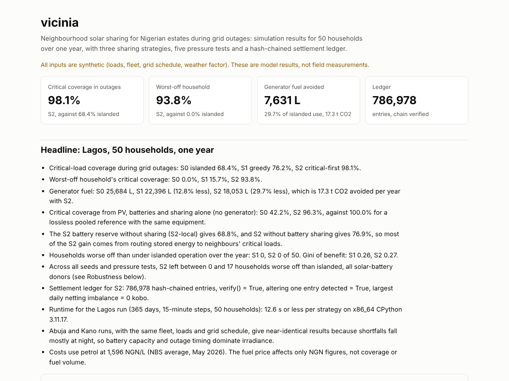
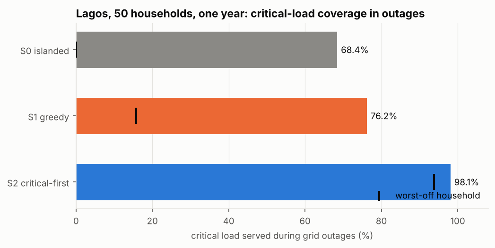
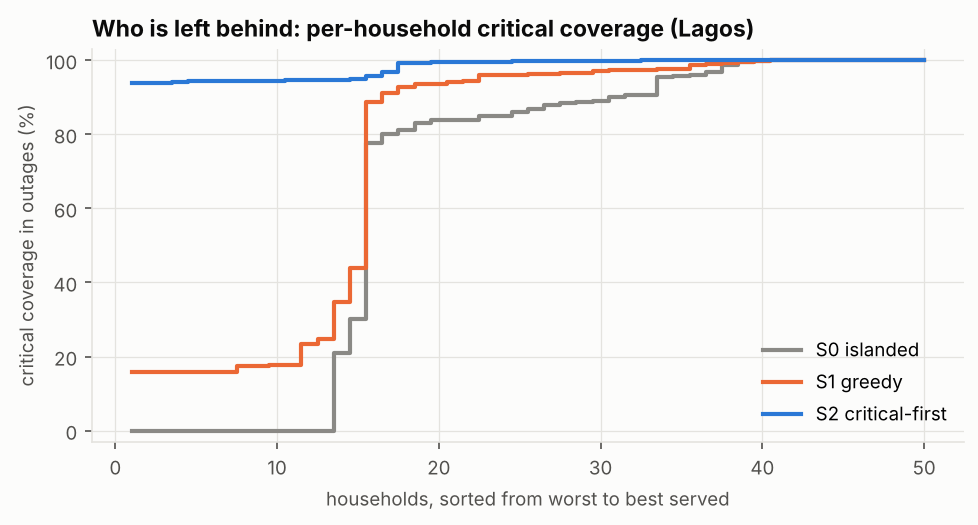

## What it is

vicinia simulates energy sharing between neighbours on Nigerian estates. It was built for HACK4EARTH 2.0, in the Resilient track.

When the grid goes down, homes with solar panels and batteries share their spare power with neighbours, critical needs first. Every transfer is recorded on a ledger that cannot be quietly edited.

## What it does

- Models a neighbourhood of 50 homes over a full year, in 15-minute steps. Homes have solar and batteries, batteries only, grid only, or a medical device that must stay on.
- Models grid supply using the regulator's (NERC) supply-hour bands, load shedding and multi-day blackouts.
- Compares three ways to run the neighbourhood: every home for itself, first come first served, and critical needs first.
- Records every transfer with its price in kobo, so the daily accounts balance to the last kobo.
- Runs pressure tests: a 72-hour blackout, a cloudy harmattan week, the biggest solar home dropping out, half the line capacity, and a communications failure.

## How it works

Solar output comes from standard solar models for Lagos, Abuja and Kano, with random cloud, rainy-season overcast and harmattan dust.

Every 15 minutes, spare solar goes first to neighbours' critical loads, such as lights, fans, fridges, phone charging and medical devices. Batteries keep a reserve for their own home's critical needs and share what is above it. Generators run only when nothing else can cover a home.

Each ledger entry is linked to the one before it by a SHA-256 fingerprint. Changing any past entry breaks the chain, and the check catches it. Automated tests on many randomly generated neighbourhoods confirm that every unit of energy is accounted for, line limits are respected and the ledger matches the real flows.

## Results

Lagos, 50 homes, one year. All inputs are synthetic, so these are model results, not field measurements.

- Critical power during outages rose from 68.4% to 98.1%.
- The worst-off household went from 0% to 93.8% of its critical needs covered.
- Generator fuel fell from 25,684 to 18,053 litres a year, about 30% less. That avoids about 17 tonnes of CO2 a year.
- No household ended up worse off than going it alone.

## Who it is for

- Solar installers and mini-grid developers in Nigeria and West Africa.
- Estate managers and residents' associations planning shared power.
- Energy policy researchers, NGOs and funders.

## What you get with access

- The full source code on GitHub, free to use under the Apache 2.0 licence.
- One command that reproduces every number and chart, in under ten minutes.
- A self-contained report you can open in any browser.
